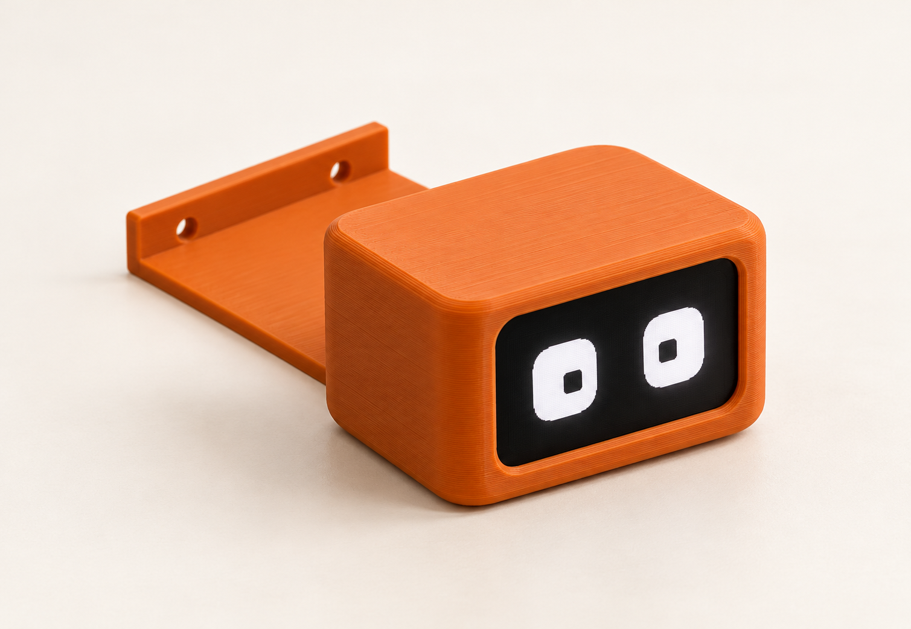
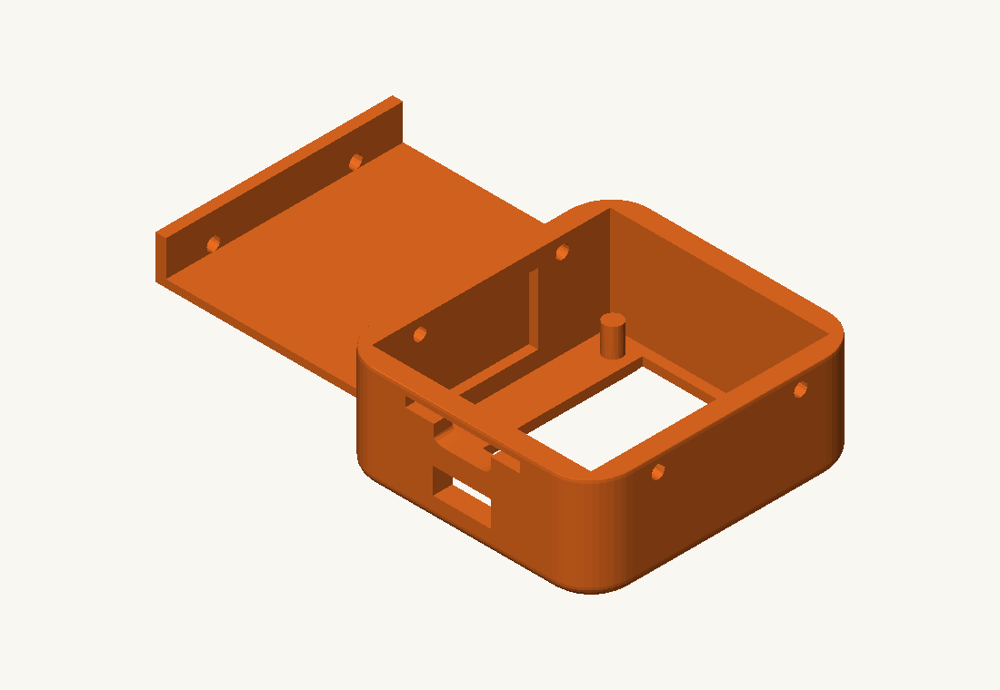
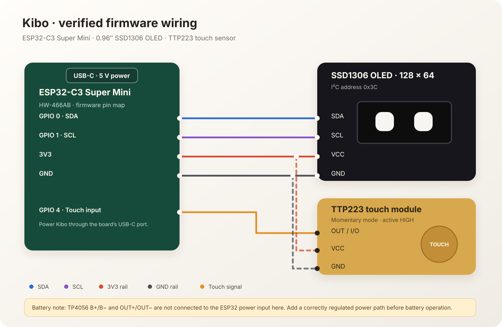
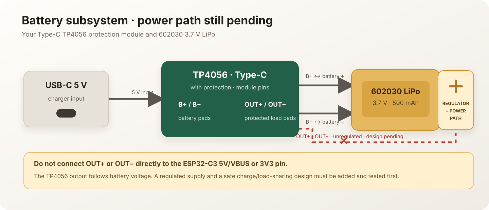

# Kibo 🍊

**A tiny desk buddy with a big mood.** Kibo is an ESP32-C3 desktop companion with an animated OLED face, touch interaction, a clock, weather pages, and a tiny arcade.

> **Build status:** The firmware and enclosure STL are in this repository. Case-to-component fit and battery power path are prototypes and still need physical validation.

<!-- TODO: Add assembled concept / photo of printed unit -->
<!--  -->
> _📷 Assembled photo / concept render coming soon._

## What Kibo does

- Expressive eyes, blinking, glances, sleep and wake animations, and context-aware reactions.
- Remembers mood-related values, familiarity, pet count, and touch history across restarts.
- Uses a TTP223 capacitive touch sensor for taps, multi-taps, holds, petting, and game input.
- Shows a local clock, optional world clock, weather, and forecast pages.
- Includes two touch games: **Flappy Kibo** and **Blink Reflex**.
- Hosts a phone-friendly setup page for Wi-Fi, timezone, weather cities, and other settings.

Kibo runs on the ESP32-C3. It does not currently have a microphone, speaker, battery gauge, or charging-status input.

## The physical build

### Current enclosure model

<!-- TODO: Add enclosure render / photo -->
<!--  -->
> _📷 Enclosure render / photo placeholder — STL preview to be updated._

The mesh has two separated components. Its approximate overall bounds are **79.8 × 49.0 × 17.5 mm**, assuming the STL coordinate units are millimetres. Confirm the dimensions and part orientation in your slicer before printing.

- Enclosure file: [Kibo.stl](Kibo.stl)
- Renderer used for the preview: [tools/render_case.py](tools/render_case.py)
- The repository currently has the STL, but not its editable CAD source.
- The case has not yet been fit-tested with the OLED, ESP32 board, touch sensor, or battery. Treat the print as a prototype and check clearances before final assembly.

### Parts list

| Part | Current choice | Notes |
| --- | --- | --- |
| Microcontroller | ESP32-C3 Super Mini, HW-466AB | Firmware uses GPIO 0, 1, and 4 for display and touch. |
| Display | SSD1306 I²C OLED, 128 × 64, usually 0.96 in | Firmware uses I²C address `0x3C`. Check your module’s labels. |
| Touch input | TTP223 touch module | Firmware expects momentary, active-HIGH output. |
| Enclosure | 3D-printed `Kibo.stl` | Two STL components; physical fit is not yet verified. |
| Normal power | USB-C to the ESP32-C3 board | This is the power arrangement currently documented for Kibo. |
| Battery parts on hand | Type-C TP4056 charger/protection module and 3.7 V 500 mAh 602030 LiPo | Battery operation is not yet integrated or validated; see the power note below. |

### Firmware wiring



| ESP32-C3 | Connects to | Purpose |
| --- | --- | --- |
| `3V3` | OLED `VCC`; TTP223 `VCC` | Logic-module power |
| `GND` | OLED `GND`; TTP223 `GND` | Shared ground |
| `GPIO 0` | OLED `SDA` | I²C data |
| `GPIO 1` | OLED `SCL` | I²C clock |
| `GPIO 4` | TTP223 `OUT` / `I/O` | Touch signal |
| USB-C | ESP32-C3 USB-C port | Normal board power and firmware upload |

The firmware first tries I²C on GPIO 0/1 and has a fallback to GPIO 8/9 if the display is not found. Use the pin labels and the board variant you actually have; don’t connect by wire colour alone.

### Battery and charging: read before wiring

The TP4056 module charges a single LiPo cell. Connect the battery to `B+`/`B−`; `OUT+`/`OUT−` are the protected load terminals. **Those outputs are battery voltage, roughly 3.0–4.2 V, not a regulated 5 V or 3.3 V supply. Do not connect them directly to the ESP32-C3 5V/VBUS or 3V3 pin.**

A battery-powered Kibo needs a properly regulated supply and a power path designed for the ESP32 board. Charging while Kibo is running can also affect the TP4056’s charge-complete detection. The `5V 1A` product title alone does not confirm the safe charge current for this particular 500 mAh cell; check the battery manufacturer’s specification and the charger’s current-setting resistor. Until the power path is designed and tested, power Kibo from the ESP32 board’s USB-C port and treat the battery/charger as a separate subsystem. See the [TP4056 datasheet](https://www.toppwr.com/uploadfile/file/20230304/640301eae1260.pdf) for its charge-current setting and termination behavior.



The diagram shows the charger and battery as a separate charging subsystem. It deliberately does not show an unverified wire from the battery output to the ESP32.

## Touch controls

| Page | Gesture | Action |
| --- | --- | --- |
| Face | Single tap | Play reaction |
| Face | Double tap | Open time page |
| Face | Hold | Pet Kibo |
| Face | Three rapid taps | Fed-up reaction; sleep follows if the burst ends there |
| Face | Four or more rapid taps | Eye-roll/faint sequence, then doze and recover |
| Time | Single tap | Toggle analog/digital clock |
| Time | Double tap | Open weather |
| Time | Hold | Open world clock (when time sync is ready) |
| Weather | Single tap | Toggle °C/°F |
| Weather | Double tap | Open forecast |
| Weather / forecast | Hold | Switch to the next configured city |
| Forecast | Double tap | Open arcade |
| Arcade menu | Single tap | Start the selected game |
| Arcade menu | Double tap | Switch between the games |
| Arcade menu | Hold | Return to face |
| In a game | Tap | Game input |
| In a game | Hold | Exit to the arcade menu |

The exact feel depends on the TTP223 module and the firmware constants. The controls above describe the current `Kibo.ino` gesture logic.

## Flash the firmware

### Requirements

- Arduino IDE 2.x.
- Espressif’s `esp32` board package.
- Libraries: `Adafruit GFX Library`, `Adafruit SSD1306`, and `Arduino_JSON`.
- Keep `Kibo.ino`, `qrcode.c`, and `qrcode.h` together in the sketch folder.

### Board settings

Use **ESP32C3 Dev Module** for the HW-466AB Super Mini unless your exact board package provides a matching profile. Set flash size to **4 MB**. The code uses the ESP32 Arduino core’s Wi-Fi, web server, preferences, and HTTP libraries in addition to the libraries listed above.

The current sketch is close to the default 1.2 MB application partition limit. If compilation reports `text section exceeds available space`, select a larger application partition in the board menu if your installed ESP32 core offers one. This firmware does not use SPIFFS. Keep **Erase All Flash Before Sketch Upload** disabled if you want to preserve settings stored in NVS.

1. Open `Kibo.ino` in Arduino IDE.
2. Select the ESP32-C3 board and the port for your device.
3. Confirm the partition has enough room for the compiled sketch.
4. Upload over USB-C.

## First-time setup

1. On first boot, Kibo starts the `Kibo-Setup` Wi-Fi access point if no saved Wi-Fi network is available.
2. Connect your phone to that network. The firmware’s default setup password is `12345678`; change it in the setup page.
3. Open `http://192.168.4.1` if the page does not open automatically.
4. Add Wi-Fi credentials, timezone, and optional weather settings. Up to four weather cities are supported. OpenWeatherMap requires your own API key.
5. Save and restart Kibo.

Wi-Fi credentials and settings are stored in ESP32 non-volatile preferences. Don’t put personal credentials or weather API keys in source files or commit them to GitHub.

## Printing and assembly notes

- Print `Kibo.stl` at **100% scale** first; confirm the slicer’s units and bounding box.
- Use PLA or PETG and a 0.16–0.20 mm layer height as a starting point. Choose orientation and supports from the slicer preview because the STL contains separate pieces.
- Dry-fit the display and boards before closing or gluing the case. Leave room for wiring, USB-C access, and touch-sensor access.
- Test the firmware and touch sensor outside the enclosure before final assembly.
- Add photos of the actual printed parts and assembled Kibo here once the fit has been checked.

### Next enclosure revision

The current STL has no editable CAD source, and its internal clearances have not been checked against the actual modules. For a fit-tested revision with proper OLED supports, board mounts, USB access, and battery space, measure the OLED PCB and screen window, ESP32 board including its USB-C socket, TTP223 board, charger board, and battery. Clear top-and-bottom photos beside a ruler or caliper will also help capture connector and wire locations. The printed test fit can then be documented here.

## Repository layout

```text
Kibo/
├── Kibo.ino
├── qrcode.c
├── qrcode.h
├── Kibo.stl
├── tools/
│   └── render_case.py
├── .gitignore
├── docs/
│   └── images/
│       ├── kibo-concept.png
│       ├── kibo-case-render.png
│       ├── wiring.svg
│       └── battery-power-path.svg
├── LICENSE
└── README.md
```

## License

Kibo is released under the [MIT License](LICENSE). The QR-code source includes its own MIT copyright notice in `qrcode.c` (Richard Moore, 2017; inspired by Nayuki’s QR Code Generator).

---

Built by Sanket, one tiny reaction at a time. 🧡
